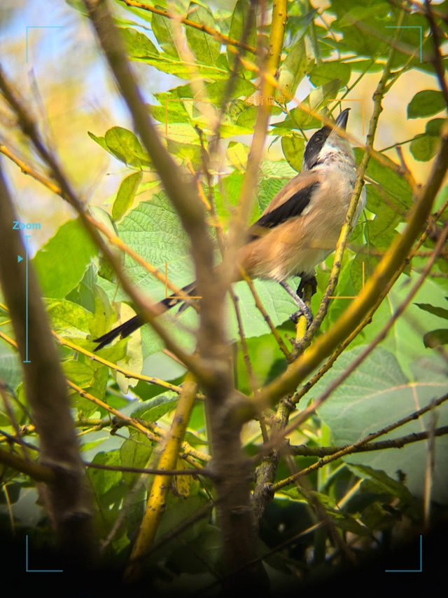

# SlateLens

[简体中文](README.md) | [English](README.en.md)

**Sheikah-style camera frame editor inspired by _The Legend of Zelda: Breath of the Wild_.**

SlateLens 是一个纯前端图片编辑器：选择本地图片，在画面上添加希卡风格的固定取景框和识别提示。项目目前处于原型阶段。

## 示例效果

<a href="docs/images/棕背伯劳-20261017.jpg"></a>

点击预览图可查看原尺寸示例。

## 当前功能

- 在浏览器中选择、预览和编辑本地图片，无需上传到服务器。
- 固定取景框始终为希卡蓝；单个追踪框可拖动、缩放，也可自定义识别名称。已记录时追踪框为希卡蓝，未记录时为橘色。
- 可按原图尺寸导出 PNG，或压缩导出 JPG（长边最多 2560 像素）。选择 JPG 图片后会默认开启压缩导出，也可以手动切换。
- 导出文件名使用 `识别名称-YYYYMMDD.png/jpg`；日期依次取拍摄日期、文件修改日期、当天。
- 适配桌面与移动端的布局。

**尚未实现：** 裁剪。画面上的 Zoom 标尺目前仅作装饰，不会改变图片缩放倍率。

## 本地运行

需要 Node.js 和 npm。在项目目录执行：

```bash
npm install
npm run dev
```

终端会显示本地预览地址。检查代码可运行：

```bash
npm run build
npm run lint
```

## 技术栈

- React、TypeScript、Vite
- [Konva / react-konva](https://konvajs.org/)：图片预览与可拖动图形
- [zelda-hyrule-ui](https://github.com/chaos-xxl/zelda-hyrule-ui)：编辑器界面组件

## 声明

本项目是受《塞尔达传说：旷野之息》启发的**非官方粉丝项目**，与任天堂没有关联，也未获得其背书。游戏名称及相关标识归各自权利人所有。项目使用的第三方组件遵循各自的许可证。

本仓库目前尚未为项目源码指定开放使用的许可证。
